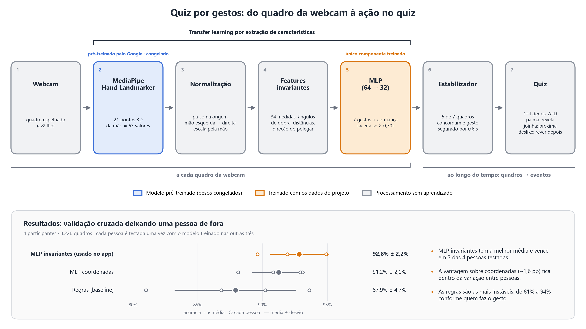
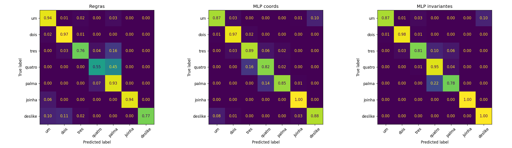

# Quiz por Gestos — Visão Computacional

Quiz de múltipla escolha controlado por **gestos de mão na webcam**. O usuário responde mostrando de 1 a 4 dedos (alternativas A–D), confirma com a palma aberta e avalia a pergunta com joinha ou deslike. Nenhum teclado ou mouse é necessário.

Trabalho da disciplina **T15 – Visão Computacional** da pós-graduação em Ciência de Dados.



---

## Sumário

1. [Como rodar (rápido)](#1-como-rodar-rápido)
2. [Como jogar](#2-como-jogar)
3. [Técnicas de visão computacional utilizadas](#3-técnicas-de-visão-computacional-utilizadas)
4. [Resultados](#4-resultados)
5. [Reproduzir o experimento completo](#5-reproduzir-o-experimento-completo)
6. [Estrutura do repositório](#6-estrutura-do-repositório)
7. [Problemas comuns](#7-problemas-comuns)

---

## 1. Como rodar (rápido)

**Requisitos:** **Python 3.12** e uma webcam. As versões das bibliotecas estão fixadas em `requirements.txt` e foram testadas com Python 3.12 no Windows 11. Se o seu Python padrão for outro, instale o 3.12 em [python.org](https://www.python.org/downloads/release/python-31210/) e crie o ambiente com ele, como abaixo.

O repositório já traz o **modelo treinado** e o **dataset coletado**, então o quiz roda sem precisar coletar nem treinar nada.

```bash
git clone https://github.com/luishmu/quiz-gestos-visao-computacional.git
cd quiz-gestos-visao-computacional

# Windows:
py -3.12 -m venv .venv
.venv\Scripts\activate

# Linux/macOS:
python3.12 -m venv .venv
source .venv/bin/activate

pip install -r requirements.txt
python app_quiz.py
```

Opções:

| Parâmetro | Descrição |
|---|---|
| `--camera 1` | usa outra webcam (padrão: `0`) |
| `--perguntas perguntas_visao.json` | troca as perguntas de conhecimento geral por perguntas sobre visão computacional |

> Na primeira execução o detector de mãos do MediaPipe (`modelos/hand_landmarker.task`) já está no repositório; se for apagado, é baixado automaticamente.

## 2. Como jogar

| Gesto | Ação no quiz | Tecla de reserva |
|---|---|---|
| ☝️ 1 dedo (indicador) | escolhe **A** | `1` |
| ✌️ 2 dedos | escolhe **B** | `2` |
| 3 dedos | escolhe **C** | `3` |
| 4 dedos | escolhe **D** | `4` |
| 🖐️ palma aberta | confirma a resposta / avança | `espaço` |
| 👍 joinha | "fácil" — vai para a próxima | `j` |
| 👎 deslike | "errei" — a pergunta volta para o fim da fila | `d` |
| — | sair | `q` |

**Importante:** nos gestos de número o **polegar fica dobrado** (é assim que o modelo foi treinado).

Fluxo de uma pergunta: escolha a alternativa (1–4 dedos) → mostre a palma para revelar a resposta → joinha/palma para avançar ou deslike para revisar depois. Um gesto só dispara depois de ser **segurado por ~0,6 s** (a barra embaixo da imagem enche) e só dispara de novo quando a mão muda de gesto, o que evita cliques acidentais.

---

## 3. Técnicas de visão computacional utilizadas

O projeto segue um pipeline clássico de reconhecimento de gestos em duas etapas: **um modelo pré-treinado extrai a pose da mão** e **um classificador leve, treinado por nós, reconhece o gesto**.

### 3.1 Captura e pré-processamento da imagem (OpenCV)

- Captura de vídeo em tempo real com `cv2.VideoCapture`.
- **Espelhamento horizontal** (`cv2.flip`) do quadro antes da detecção, para a imagem se comportar como um espelho. O mesmo espelhamento é aplicado na coleta e no app — caso contrário, a lateralidade (mão esquerda/direita) informada pelo detector se inverteria entre treino e uso.
- Conversão de espaço de cor **BGR → RGB** (o OpenCV trabalha em BGR; o MediaPipe espera RGB).

### 3.2 Detecção de mão e estimação de pontos-chave (MediaPipe Hand Landmarker)

- Uso do **MediaPipe Hand Landmarker** (Tasks API), uma rede neural do Google que, a cada quadro, localiza a mão e estima **21 pontos anatômicos em 3D** (pulso, articulações e pontas dos dedos) — técnica de *hand pose estimation* / *keypoint detection*.
- Executado em modo `VIDEO`, que aproveita a continuidade temporal entre quadros (rastreamento) em vez de detectar do zero a cada imagem.
- Também informa a **lateralidade** (mão esquerda ou direita).
- Os pontos são desenhados sobre a imagem (esqueleto da mão) como retorno visual.

### 3.3 Transfer learning por extração de características

O Hand Landmarker funciona como **backbone pré-treinado e congelado**: seus pesos não são alterados. Só a "cabeça" (o classificador) é treinada com os nossos dados. Isso permite treinar com poucos milhares de quadros, torna o modelo insensível a fundo, iluminação e tom de pele (o classificador nunca vê pixels) e roda em tempo real na CPU. A discussão completa está em [`transfer_learning.md`](transfer_learning.md).

### 3.4 Normalização geométrica dos pontos

Para o gesto ser reconhecido independentemente de **onde** a mão está na tela, de **quão perto** está da câmera e de **qual mão** é usada (`gestos_comum.normalizar`):

1. **Translação:** o pulso (ponto 0) vira a origem.
2. **Espelhamento:** a mão esquerda é espelhada no eixo x para parecer uma mão direita.
3. **Escala:** as coordenadas são divididas pela maior distância 2D até o pulso.

Resultado: um vetor de 63 números (21 pontos × x, y, z).

### 3.5 Engenharia de features invariantes

A partir do vetor normalizado são calculadas 34 medidas que dependem do **formato do gesto** e não da anatomia de quem o faz (`gestos_comum.features_invariantes`):

- 15 **ângulos de dobra** dos dedos (cosseno entre segmentos consecutivos, em 3D);
- distâncias **ponta → pulso** e **entre pontas vizinhas**, relativas ao tamanho da palma;
- distância **polegar → base do indicador** (polegar dobrado ou esticado);
- **direção da palma e do polegar** em 2D (separa joinha de deslike, que diferem só pela direção do polegar);
- **altura das pontas** em relação ao pulso.

### 3.6 Classificação

Três abordagens foram comparadas:

| Abordagem | Descrição |
|---|---|
| **Regras (baseline)** | Conta dedos esticados comparando distâncias ao pulso e decide por `if/else`, sem aprendizado. |
| **MLP sobre coordenadas** | Perceptron multicamadas (64 → 32 neurônios, scikit-learn) sobre as 63 coordenadas normalizadas. |
| **MLP sobre features invariantes** | O mesmo MLP sobre as 34 features da seção 3.5. **É o modelo usado no app.** |

O cálculo das features fica dentro do `Pipeline` do scikit-learn, então o modelo salvo recebe diretamente o vetor de 63 coordenadas.

### 3.7 Estabilização temporal (pós-processamento)

A previsão quadro a quadro oscila. O `Estabilizador` (`app_quiz.py`) transforma essa sequência ruidosa em eventos confiáveis:

- descarta previsões com probabilidade < 70%;
- **votação majoritária** nos últimos 7 quadros (mínimo de 5 votos iguais);
- o gesto precisa ser **mantido por 0,6 s** para disparar;
- **rearme** só depois que o gesto muda ou a mão sai da imagem.

### 3.8 Avaliação sem vazamento de dados

Quadros vizinhos de um vídeo são praticamente idênticos; dividir treino/teste quadro a quadro faria o modelo "ver" o teste e inflaria a acurácia. Por isso a avaliação é feita **por pessoa**:

- **`LeaveOneGroupOut`**: cada participante é usado uma vez como teste de um modelo treinado só com os outros — mede a generalização para **pessoas que o modelo nunca viu**;
- **`GroupShuffleSplit`** para o relatório por classe e a matriz de confusão.

### 3.9 Interface

O quiz é desenhado com **Pillow** sobre a imagem da câmera (o `cv2.putText` não renderiza acentos) e exibido com `cv2.imshow`.

---

## 4. Resultados

Dataset: **8.228 quadros** de **4 participantes**, 7 gestos, aproximadamente balanceado (~2.050 quadros por pessoa).

Validação cruzada deixando uma pessoa de fora (média ± desvio entre os 4 participantes):

| Modelo | Acurácia | F1 macro |
|---|---|---|
| Regras (baseline) | 87,9% ± 4,7% | 0,882 |
| MLP sobre coordenadas | 91,2% ± 2,0% | 0,913 |
| **MLP sobre features invariantes** | **92,8% ± 2,2%** | **0,929** |

- As duas redes superam o baseline por regras e são **mais estáveis entre pessoas** (desvio menor). As regras variam de 81% a 94% conforme o participante.
- As features invariantes trazem um ganho pequeno (~1,6 p.p.), dentro da variação entre pessoas.
- Os erros restantes se concentram em **quatro**, **palma** e **três**; **joinha** foi classificado sem erros.

Matriz de confusão (normalizada por classe real), split com participantes nunca vistos no teste:



---

## 5. Reproduzir o experimento completo

```bash
# 1) (opcional) coletar novas amostras — abre a webcam
python coletar_gestos.py --pessoa <seu_nome> [--camera 1]
#    teclas: 1..7 escolhe o gesto · ESPAÇO grava/pausa · q sai
#    grava 300 quadros por gesto e para sozinho; mexa a mão enquanto grava

# 2) (opcional) avaliar o modelo atual na pessoa nova, ANTES de retreinar
python avaliar_pessoa.py --pessoa <seu_nome>

# 3) treinar: compara os 3 modelos, imprime a validação cruzada,
#    salva matriz_confusao.png e modelos/mlp_gestos.joblib
python treinar_gestos.py

# 4) (opcional) regenerar o diagrama do pipeline
python gerar_diagrama.py
```

O treino roda na CPU e não precisa de webcam.

---

## 6. Estrutura do repositório

```
├── app_quiz.py             # aplicação do quiz (webcam + modelo + interface)
├── gestos_comum.py         # detector MediaPipe, normalização, features e baseline por regras
├── coletar_gestos.py       # coleta de dados pela webcam → dados/gestos.csv
├── treinar_gestos.py       # treino, comparação dos modelos e validação cruzada
├── avaliar_pessoa.py       # avalia o modelo salvo em uma pessoa específica
├── gerar_diagrama.py       # gera diagrama_pipeline.png/.svg
├── perguntas.json          # perguntas de conhecimento geral (padrão)
├── perguntas_visao.json    # perguntas sobre visão computacional
├── transfer_learning.md    # discussão sobre transfer learning na arquitetura
├── dados/gestos.csv        # dataset: 63 coordenadas normalizadas + lado, pessoa, sessão, classe
├── modelos/
│   ├── hand_landmarker.task  # modelo pré-treinado do MediaPipe
│   └── mlp_gestos.joblib     # classificador treinado
├── diagrama_pipeline.png   # visão geral do pipeline
├── matriz_confusao.png     # matriz de confusão dos 3 modelos
└── requirements.txt
```

O dataset guarda apenas as **coordenadas normalizadas dos pontos da mão**, sem nenhuma imagem. Os participantes estão **anonimizados** (`pessoa1` a `pessoa4`).

Para criar suas próprias perguntas, siga o formato de `perguntas.json` (`correta` é a letra A–D) e passe o arquivo com `--perguntas`.

---

## 7. Problemas comuns

| Sintoma | Solução |
|---|---|
| `Não consegui abrir a webcam` | Tente `--camera 1` (ou 2); feche outros programas que usam a câmera. |
| Erro ou aviso ao carregar `mlp_gestos.joblib` | Versão do scikit-learn diferente da usada no treino. Instale a do `requirements.txt` ou rode `python treinar_gestos.py` para gerar o modelo de novo. |
| `pip install` falha ou não encontra alguma versão | Confira se o ambiente virtual usa Python 3.12 (`python --version`); o MediaPipe não publica pacotes para toda versão de Python. |
| Gesto não é reconhecido | Boa iluminação, mão inteira dentro da imagem, a 40–80 cm da câmera; nos números, polegar dobrado. |
| `FileNotFoundError` do MediaPipe em pasta com acento | Já tratado: o modelo é passado ao MediaPipe em bytes (`model_asset_buffer`). |

---

**Tecnologias:** Python · OpenCV · MediaPipe · scikit-learn · NumPy · pandas · Matplotlib · Pillow
